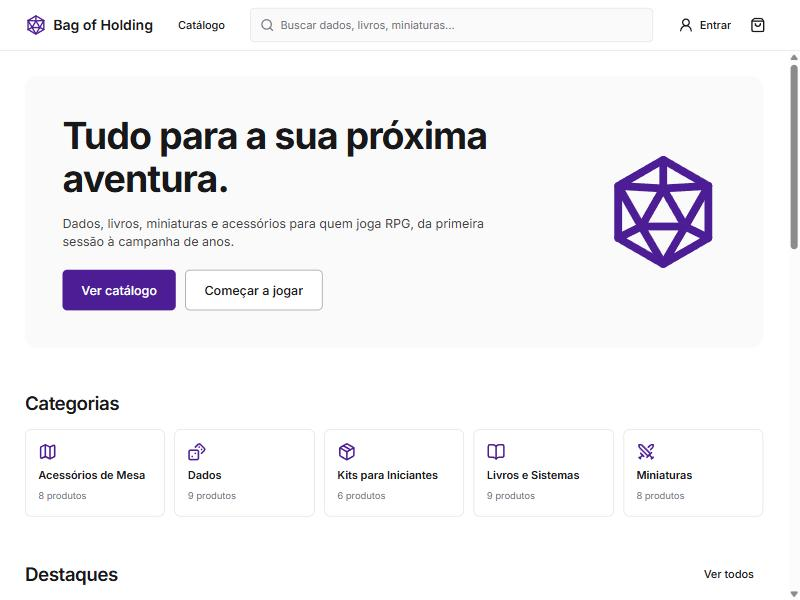
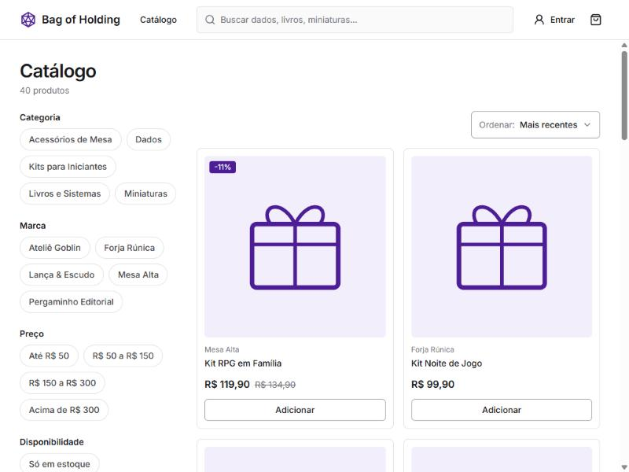
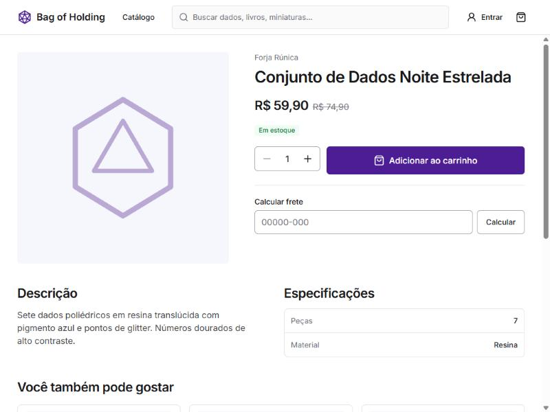
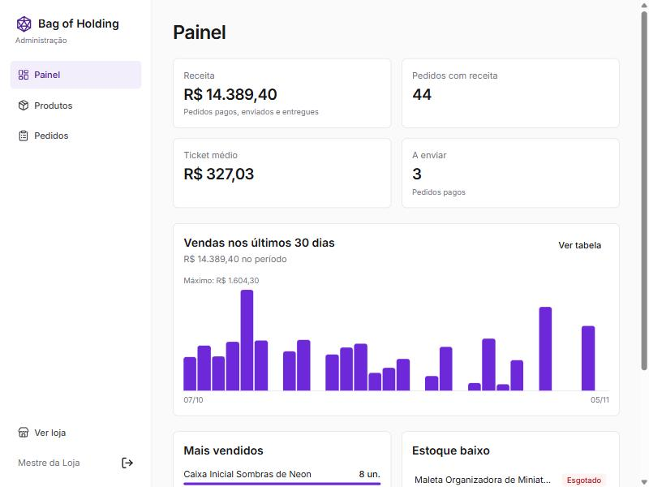
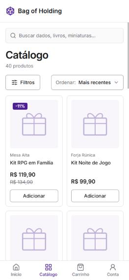

# Bag of Holding

Loja online mock de produtos para jogadores de RPG, com site e app feitos a partir do mesmo código. É um projeto de portfólio: os produtos e as marcas são fictícios, e o pagamento é simulado.

O plano completo está em [docs/PLANO.md](docs/PLANO.md). O projeto ainda não está publicado; os passos estão em [docs/DEPLOY.md](docs/DEPLOY.md).



| Catálogo | Produto |
|---|---|
|  |  |

| Painel administrativo | No celular |
|---|---|
|  |  |

## O que tem

- **Loja:** catálogo com busca, filtros e ordenação; carrinho de visitante unido ao da conta no login; frete por região.
- **Compra:** checkout com pagamento simulado (aprovado ou recusado), histórico de pedidos e endereços preenchidos pelo CEP com o ViaCEP.
- **Admin:** painel de vendas, produtos, estoque e status dos pedidos.
- **Regras no backend:** baixa de estoque em transação com bloqueio, estorno ao cancelar e transições de status validadas.

## Stack

- **Backend:** Laravel, Sanctum, MySQL e Pest, rodando em Docker.
- **Frontend:** Expo, Expo Router, React Native Web, NativeWind, TanStack Query e Zustand.

## Como rodar

É preciso ter Docker e Node.js 24 instalados.

### API

Disponível em `http://localhost:8000/api/v1`.

```bash
cp backend/.env.example backend/.env
```

```bash
docker compose up -d --build
```

```bash
docker compose exec app composer install
```

```bash
docker compose exec app php artisan key:generate
```

```bash
docker compose exec app php artisan migrate --seed
```

O seed cria 40 produtos, pedidos de demonstração dos últimos 30 dias e duas contas locais, ambas com a senha `password`: `admin@bagofholding.test` e `cliente@bagofholding.test`.

Para voltar o banco ao estado inicial (apaga todos os dados locais):

```bash
docker compose exec app php artisan migrate:fresh --seed
```

### Site e app

```bash
cd mobile
```

```bash
npm install
```

```bash
cp .env.example .env
```

```bash
npm run web
```

Em desenvolvimento, os componentes da interface podem ser vistos em `http://localhost:8081/design`.

## Testes e qualidade

```bash
docker compose exec app php artisan test
```

O teste de concorrência do estoque roda à parte, em MySQL de verdade:

```bash
docker compose exec app vendor/bin/pest --configuration=phpunit.mysql.xml
```

```bash
docker compose exec app vendor/bin/pint --test
```

```bash
npm --prefix mobile run lint
```

```bash
npm --prefix mobile run typecheck
```
